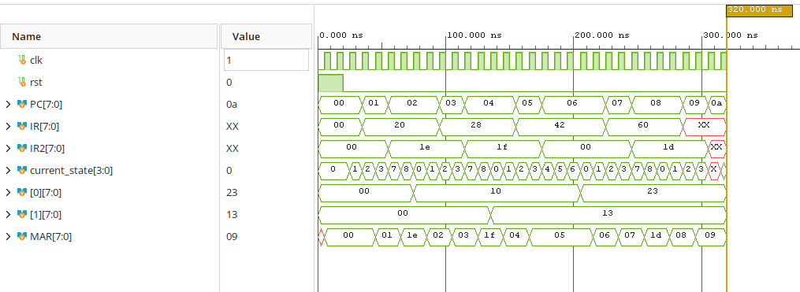

# 8-bit CPU in Verilog
 
A custom 8-bit CPU designed from scratch in Verilog: my own instruction set, a 4-register file, a small RAM, an ALU, and a multi-cycle finite-state-machine control unit, all sharing a single data bus.
 
**Website:** https://hiitsmike1.github.io/michaelcrandall.github.io/
 
 
## Overview
 
I built this CPU to understand how a processor works at the register-transfer level: how instructions are fetched and decoded, how a control unit sequences the datapath, and how several blocks share one bus without fighting over it.
 
- **8-bit datapath** with a shared data bus
- **4-register file**
- **RAM** addressed through a 8-bit memory address register (MAR), giving **256 addressable bytes** 
- **ALU** supporting ADD, SUB, AND, OR, XOR, SHL, and SHR 
- **Multi-cycle control unit** (module `iu`) built as a finite-state machine
- **Custom instruction set:** LOAD, STORE, ALU
## Architecture
 
| Block | Module | Role |
|-------|--------|------|
| Register file | [`reg_file`] | Four 8-bit registers |
| RAM | [`ram`] | Program and data storage, addressed through MAR |
| ALU | `alu` | Arithmetic and logic |
| Control unit | `iu` | FSM that holds PC, IR, and IR2 and generates every enable and load signal |
| Top level | [`top`] | Connects everything to the shared bus |
 

 

 
### Shared data bus
 
All blocks put their data on one 8-bit bus. Instead of true tri-state drivers, the bus is arbitrated by a priority mux driven by four enable signals from the control unit: `en_alu`, `en_ram`, `en_reg`, and `en_iu`. Only one block drives the bus in a given cycle. Separate `set_*` signals tell a block to latch whatever is on the bus.
 
## Instruction Set
 Every instruction is two bytes. Byte 1 holds the instruction type, register selections, and carry-in, and byte 2 (stored in `IR2`) holds the address or ALU operation depending on the opcode.
| Instruction | Opcode `IR[7:5]` | Length | Effect |
|-------------|------------------|--------|--------|
| `LOAD Rn, [addr]`  | `001` | 2 bytes | `Rn = mem[addr]` |
| `ALU Ra, Rb, op`       | `010` | 2 byte  | `Ra = ALU(Ra, Rb, op, c_in)` |
| `STORE Rn, [addr]` | `011` | 2 bytes | `mem[addr] = Rn` |
 
**ALU (2 bytes):**
 
| Byte | Bits | Field |
|------|------|-------|
| 1 | `[7:5]` | opcode (`010`) |
| 1 | `[4:3]` | register for operand A (also the destination) |
| 1 | `[2:1]` | register for operand B |
| 1 | `[0]` | carry in value for ALU |
| 2 | `[7:5]` | ALU operation (table below) |
| 2 | `[4:0]` | unused |
 
| Encoding | Operation |
|------|------|
| 000 | ADD | 
| 001 | SUB | 
| 010 | AND | 
| 011 | OR | 
| 100 | XOR | 
| 101 | SHL | 
| 110 | SHR | 

**LOAD and STORE (2 bytes):**
 
| Byte | Bits | Field |
|------|------|-------|
| 1 | `[7:5]` | opcode (`001` LOAD, `011` STORE) |
| 1 | `[4:3]` | register used for operation |
| 1 | `[2:0]` | unused |
| 2 | `[7:0]` | 8-bit memory address |

## Control Unit
 
The FSM fetches one instruction byte at a time, then runs a path that depends on the opcode. The PC increments after each byte fetched.
 
| State | What happens |
|-------|--------------|
| FETCH1 | PC goes onto the bus and into MAR |
| FETCH2 | RAM drives the bus, IR latches the byte, PC increments |
| FETCH3 | PC goes onto the bus and into MAR (second byte) |
| FETCH4 | RAM drives the bus, IR2 latches the byte, PC increments |
| ALU1 | `reg_a` goes onto the bus and into the ALU's internal register |
| ALU2 | `reg_b` goes onto the bus and the ALU computes |
| ALU3 | ALU result goes onto the bus and is written back to `reg_a` |
| EXEC1 | The address in `IR2` goes onto the bus and into MAR |
| EXEC2 | LOAD: RAM to register. STORE: register to RAM |
 
- **ADD takes 7 cycles** (FETCH1 to FETCH4, then ALU1 to ALU3).
- **LOAD and STORE take 6 cycles** (FETCH1 to FETCH4, then EXEC1 and EXEC2).

 
## Example Program
 
This program loads 25 and 10 from memory, adds them, and stores the result.
 
**Source and machine code**
 
| Address | Bytes | Instruction | Effect |
|---------|-------|-------------|--------|
| 0, 1 | `20 1E` | `LOAD R0, [30]` | R0 = 25 |
| 2, 3 | `28 1F` | `LOAD R1, [31]` | R1 = 10 |
| 4, 5 | `42 00` | `ADD R0, R1` | R0 = 35 (`0x23`) |
| 6, 7 | `60 1D` | `STORE R0, [29]` | mem[29] = 35 |
 
**Data memory:** address 30 holds `0x19` and address 31 holds `0x0A`.
 
**How the bytes are built**

- `LOAD R0, [30]`: Opcode `001` (LOAD), register A `00` (R0), register B `00` (unused), and carry-in `0` give `00100000` = `20`. Byte 2 contains address 30 (`00011110`), giving `1E`.

- `LOAD R1, [31]`: Opcode `001` (LOAD), register A `01` (R1), register B `00` (unused), and carry-in `0` give `00101000` = `28`. Byte 2 contains address 31 (`00011111`), giving `1F`.

- `ADD R0, R1`: Opcode `010` (ALU), register A `00` (R0), register B `01` (R1), and carry-in `0` give `01000010` = `42`. Byte 2 contains ALU operation `000` (ADD) in bits `[7:5]`, giving `00000000` = `00`.

- `STORE R0, [29]`: Opcode `011` (STORE), register A `00` (R0), register B `00` (unused), and carry-in `0` give `01100000` = `60`. Byte 2 contains address 29 (`00011101`), giving `1D`.

**Expected result:** After the ADD finishes (19 clock cycles), R0 = `0x23` (35). After the STORE finishes (25 clock cycles), memory address 29 also holds `0x23`.
 
Execution continues past the end of the program through zero bytes. Opcode `000` falls into the LOAD/STORE path and does nothing in EXEC2, so zeros act as harmless two-byte no-ops.
 
## Simulation
 
The small example program above was implemented into cpu_tb.v. The program was then simulated in Vivado to verify results. The waveform image of program running is below.


 
## Design Challenges
 
**Bus contention and timing hazards.** Early versions had overlapping datapath signals, so two blocks drove the shared bus at the same time and values were captured in the wrong cycle.  I wanted to try to use tri-state buffers for each of the outputs where each module was driven by an enable signal, but I realized I could use a multiplexer to choose which datapath drives the bus.
 
**Instruction encoding.** 
 Designing the instruction format required balancing the number of operations and operands against the limited space in an 8-bit byte. I settled on a two-byte instruction format. The first byte contains the instruction type, register selections, and carry-in. The second byte is reused to store either the ALU operation or the full 8-bit memory address.

This allowed the CPU to support four general-purpose registers, seven ALU operations, and 256 addressable memory locations while keeping every instruction two bytes long.


## Repository Structure

```
8bit-cpu/
│
├── src/                         # Verilog CPU design modules
│   ├── top.v                    # Top-level CPU module
│   ├── alu.v                    # Arithmetic Logic Unit
│   ├── iu.v                     # Instruction Unit / Control FSM
│   ├── ram.v                    # 256 x 8-bit RAM
│   └── reg_file.v               # Four 8-bit general-purpose registers
│
├── sim/                         # Verilog simulation testbenches
│   ├── cpu_tb.v                 # Small Program to Test Functions
│
├── vivado/                      # Vivado project
│   └── cpu_8bit/
│       ├── cpu_8bit.xpr         # Vivado project file
│       ├── cpu_8bit.srcs/       # Vivado source set configuration
│       ├── cpu_8bit.sim/        # Generated simulation files
│       ├── cpu_8bit.runs/       # Generated synthesis/implementation files
│       └── cpu_8bit.cache/      # Vivado cache files
│
├── images/
│   └── cpu_simulation.png       # CPU simulation waveform
│
├── .gitignore
└── README.md
```

 
## Related Projects
 
- [4-bit ALU from discrete transistors (RTL)](https://github.com/hiitsmike1/alu_rtl)
- [ALU in Verilog with Verilator](https://github.com/hiitsmike1/alu_verilator)
## Author
 
Michael Crandall, B.S. Electrical Engineering, University of Maryland (expected December 2028)
[LinkedIn](https://linkedin.com/in/crandall0327) · [Portfolio](https://hiitsmike1.github.io/michaelcrandall.github.io/)